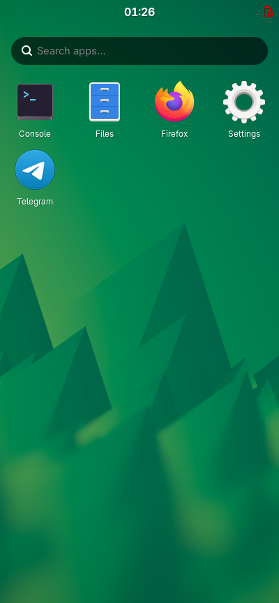

# AlpineiOS


AlpineiOS runs a local ARM64 postmarketOS virtual machine inside an iPhone app. The guest boots Phosh and sends VirtIO GPU frames to Metal.



## Requirements

- **Tested device:** iPhone 14 Pro with iOS 27.0. The app targets iOS 17. VM and JIT compatibility on other devices and OS versions is unverified.
- **Build and launch:** Apple silicon Mac, Xcode with support for the connected iPhone (tested with Xcode 27.2), Homebrew, an Apple development team for signing and Developer Mode on the iPhone.
- **Storage and network:** Allow at least 5 GB of free space on the phone for the roughly 1.9 GB download, unpacking and apps. The initial setup and package installs need internet access.

The VM uses one CPU, 1.5 GB of RAM, software rendering and a portrait 400 × 864 display. Guest audio is currently disabled.

The download includes Phosh and Settings. Firefox, Files (Nautilus), and GNOME Console are selected by default. Telegram Desktop, Mousepad, and htop are optional.

## Download and install from the app

On the first launch, choose the apps you want and tap **Download and install**. The default image is hosted on GitHub Releases. [Phosh image downloads](https://github.com/Lumid-Off/AlpineiOS-images/releases/tag/phosh-26.06-r1) AlpineiOS verifies the assets with SHA-256, unpacks the disk, then boots when JIT is available. The guest downloads the selected apps after boot. Its generated console password is in **Help**.

Set `ALPINE_IMAGE_MANIFEST_URL` at build time to use a different default URL. To create and stage the assets for your own server, run these commands on an Apple silicon Mac with QEMU and Python installed.

```sh
bash scripts/prepare_phosh.sh --downloadable work/PhoshRelease
python3 scripts/publish_phosh_image.py work/PhoshRelease work/PhoshAssets
```

Host the contents of `work/PhoshAssets` together and use the URL ending in `phosh.json`. For a test on your own Wi-Fi, serve that directory with `python3 -m http.server 8765 --directory work/PhoshAssets` and use `http://YOUR-MAC.local:8765/phosh.json` in the app. A published build should use an HTTPS URL.

## Build and manual import

Omit `ALPINE_IMAGE_MANIFEST_URL` to use the default GitHub image. Local VM preparation is optional when using an already hosted image.

1. Install the build dependencies and provision a machine.

   ```sh
   brew install qemu xcodegen meson ninja pkg-config python
   bash scripts/prepare_phosh.sh
   ```

2. Pair your iPhone with Xcode and enable Developer Mode. Build with your Apple development team and choose a unique bundle ID. [Apple Developer Mode guide](https://developer.apple.com/documentation/xcode/enabling-developer-mode-on-a-device)

   ```sh
   export ALPINE_BUNDLE_ID=com.example.alpineios
   ALPINE_IMAGE_MANIFEST_URL=https://example.com/phosh.json \
     ALPINE_DEVELOPMENT_TEAM=YOUR_TEAM_ID bash scripts/build_alpine_ios.sh

   xcrun devicectl list devices
   xcrun devicectl device install app --device YOUR_IPHONE_UDID \
     build/DerivedData/Build/Products/Release-iphoneos/WindowsiOS.app
   ```

3. Open the app once. In the iPhone Files app or Finder File Sharing, open **AlpineiOS** and create `Machines/PostmarketOS-Native` if needed. Copy `code.fd`, `vars.fd`, `seed.img` and either `alpine.hvsparse` or `alpine.img` from `work/PostmarketOS-Native`. Keep `login.txt` private. It contains the generated console password for `user`.
4. Unlock the paired iPhone and run the launch script. The app can boot once JIT is active and the VM files are present. Repeat this command after iOS terminates the app.

   ```sh
   bash scripts/launch_on_iphone.sh YOUR_IPHONE_UDID "$ALPINE_BUNDLE_ID"
   ```

Run the build script without `ALPINE_DEVELOPMENT_TEAM` to produce an unsigned `build/AlpineiOS.ipa`. The release IPA is unsigned. Build and development-sign it with your own Apple team to use the debugger-assisted launch above. The release includes the dependency sources used to build the IPA.

## Controls

- **Phosh app grid** — swipe up with two fingers from inside the desktop, or tap with three fingers and choose **Apps**.
- **App controls** — tap with three fingers. The panel includes the serial console, iOS keyboard, touch orientation and Linux shutdown.
- **Rotate in Phosh** — if taps are offset, match the touch orientation to the guest display from the controls.
- **Return to iOS** — swipe up from the bottom edge. Use the power button in the controls to shut down Linux first if you're done with the VM.

In the guest, `wget -qO- http://10.0.2.4/.henge/battery` reports the host battery level and charging state.

## Development, credits and licenses

Run `make test-core` on an Apple silicon Mac. The guest image, firmware and personal signing material are prepared locally.

This project is a fork of the WindowsiOS VM engine. [Upstream WindowsiOS](https://github.com/ammaarreshi/WindowsiOS) · [License](LICENSE) · [Third-party notices](THIRD_PARTY_NOTICES.md) · [Инструкция на русском](POSTMARKETOS-RU.md)
